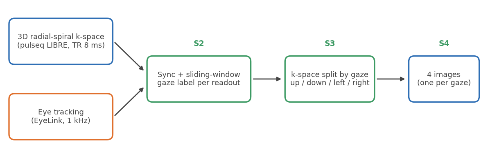
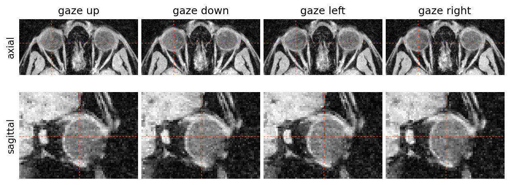

# MR-EyeTrack

Gaze-resolved 3D MRI of the eye. We acquire a T1-weighted 3D radial-spiral k-space (pulseq LIBRE) while an
MR-compatible eye tracker (SR Research EyeLink) records where the participant looks. Every k-space readout is
labelled with the gaze direction at the moment it was acquired, the readouts are binned by direction, and each bin is
reconstructed on its own. The result is four motion-resolved images per subject: **up, down, left and right**.





## Data

The full dataset (15 subjects: raw k-space, eye tracking, gaze labels and all reconstructions, in BIDS format) is on
OpenNeuro: [ds008973](https://openneuro.org/datasets/ds008973), DOI
[10.18112/openneuro.ds008973.v1.0.0](https://doi.org/10.18112/openneuro.ds008973.v1.0.0). Its README explains the
file naming. To rebuild it from `data/study`, run `analysis/conversion/build_bids_dataset.py`.

## How it works

| step | folder | what it does |
| --- | --- | --- |
| S1 | `recon/1-CoilSensitivity` | coil sensitivity maps from the body-coil and head-coil prescans |
| S2 | `recon/2-Binning` | sliding window over the synchronised eye-tracking signal gives one gaze label per readout |
| S3 | `recon/3-Mitosius` | splits the k-space into one subset per gaze direction |
| S4 | `recon/4-Recon` | gridding (`bmMathilda`) and compressed-sensing reconstruction (`bmSteva`, 20 iterations) |

The eye tracker and the scanner have separate clocks, so a per-subject offset and rate correction is applied
(`model/sync_table.py`, stored in `sync_corrections.mat`). Use the `eMask_th0.75_winLen3_sync` labels. The readout
indexing convention is described in [CLAUDE.md](CLAUDE.md) and is asserted in `model/dataset.py`.

## Repository

| folder | content |
| --- | --- |
| `recon/` | MATLAB reconstruction pipeline (S1 to S4), coil compression (`ROI-PCA`, `ROVir`), cluster job files |
| `eye_tracker/` | EyeLink EDF to BIDS conversion and the gaze mask generation used by S2 |
| `visual_stimuli/` | PsychoPy fixation paradigms shown in the scanner |
| `analysis/` | NIfTI conversion, image-quality metrics, undersampling study, orientation checks |
| `model/` | investigation of whether gaze can be decoded from individual readouts (read `model/README.md`) |
| `docs/` | README figures (`python docs/make_readme_figures.py`) |

## Running a reconstruction

You need MATLAB with the [monalisa](https://github.com/MattechLab/monalisa) and pulseq libraries on the path. For one
subject:

```matlab
subject_num = 5;
mask_type   = 'clean';   % 'clean' | 'clean_0.50' | 'clean_0.75' | 'clean_0.95'
region_idx  = 0;         % 0 = up, 1 = down, 2 = left, 3 = right
run('recon/1-CoilSensitivity/S1_CalCoilSensitivity_jb_pulseq.m')
run('recon/2-Binning/S2_eyeMask_t1_binning_pulseq.m')
run('recon/3-Mitosius/S3_mitosius_binning_pulseq.m')
run('recon/4-Recon/S4_recon_debi_4fr_pulseq.m')
```

All subjects at once: `bash recon/4-Recon/run_resume_recon_logged.sh` (skips outputs that already exist). Convert
the `.mat` results to NIfTI with `mat2nii_single` (`analysis/conversion/`). Paths, variables and the pipeline
internals are documented in [CLAUDE.md](CLAUDE.md).

## License

CC0 1.0, see [LICENSE](LICENSE). `eye_tracker/hcph-sops-fork` is a fork of the HCPh SOPs and keeps its original Apache 2.0
license.
